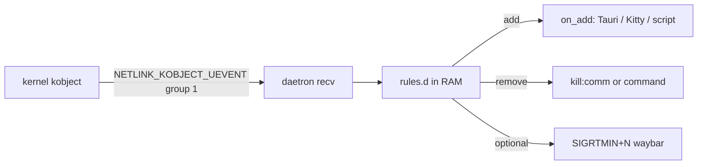
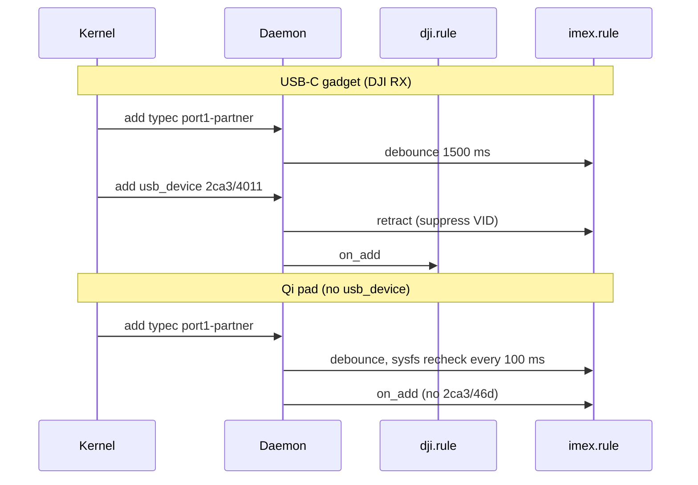

# daetron

> A small C sleeper that turns raw kernel plug/unplug events into a command — no libudev, no 2-second sysfs poll.


daetron binds `NETLINK_KOBJECT_UEVENT` multicast **group 1** (kernel kobject, not udev group 2), loads drop-in `rules.d/*.rule` files into memory, and execs/kills on match. The applet can be Tauri, Kitty, or a script — that is `on_add`, not C.

Measured 2026-09-03 on an AMD X870 / NixOS box against the three live bash watchers it is meant to replace.

## Results

One daemon vs three `sleep 2` loops. Same three devices: DJI Mic Mini 2 RX (`2ca3:4011`), Logitech Lightspeed (`046d:c53f`), IMEX Qi pad (typec `port*-partner`).

| process | RSS | CPU idle | how it waits | plug latency |
|---|---:|---:|---|---|
| micmini2-watch (bash) | 4784 KB | 0.2% | `sleep 2` + sysfs | 0–2 s |
| mother-watch (bash) | 4808 KB | 0.2% | `sleep 2` + sysfs | 0–2 s |
| imex-watch (bash) | 4788 KB | ~0% | `sleep 2` + sysfs | 0–2 s |
| **three watchers together** | **~14.4 MB** | **~0.4%** | poll | 0–2 s |
| daetron dump (musl) | 68 KB | 0 ticks / 3 s | `recv` | event |
| **daetron run** (3 rules) | **160 KB** | **0 ticks** | `recv` | event (IMEX +1.5 s debounce) |
| daetron glibc (dump, not default) | 1492 KB | 0 ticks | `recv` | event |

~90× less RSS than the three pollers. CPU is a blocked syscall, not a timer. Disk image is 92 KB static.

```mermaid
xychart-beta
    title "Idle RSS in KB"
    x-axis ["micmini2" "mother" "imex" "daetron"]
    y-axis "KB" 0 --> 5200
    bar [4784, 4808, 4788, 160]
```

Kernel noise vs what the dispatcher acts on (full plug cycle, `captures/field-2026-09-03-*`):

| capture | kernel uevents | dispatcher actions |
|---|---:|---:|
| DJI RX in+out | 80 | 1 add + 1 remove (`usb_device` only) |
| DJI + logi + pad + DJI | 229 | 12 tagged add/remove before debounce/retract |

USB interface / HID / input / sound bursts are why `DEVTYPE=usb_device` is the USB gate. Matching every `PRODUCT=2ca3/4011` line would spawn the applet many times (the old six-copy bug).

### Dry-run log (cycle 3, 2026-09-03)

`--dry-run -v`. No applets spawned. Full file: [`captures/dryrun-2026-09-03-ok-field.txt`](captures/dryrun-2026-09-03-ok-field.txt).

```
13:35:15 add imex
13:35:15 retract imex (saw 2ca3/4011/0)
13:35:15 add dji
13:35:19 skip remove imex: never started
13:35:19 remove dji
13:35:24 add logi
13:35:30 remove logi
13:35:33 add imex
13:35:36 remove imex
```

| plug | expected | observed |
|---|---|---|
| DJI RX (USB-C) | dji only | false IMEX add retracted when `2ca3/4011/0` arrived; then `add dji` |
| Lightspeed dongle (USB-A) | logi only | `add logi` / `remove logi`, no typec |
| IMEX pad | imex only | `add imex` after debounce, no retract |

> [!NOTE]
> Live `*-watch.service` units are **not** swapped yet. These numbers are the sleeper + dry-run dispatcher. A non-dry `run` as the systemd trigger is the next step.

## Approach

udev is a second userspace netlink (group 2) on top of the kernel multicast. `udevadm monitor` leftovers also held a flock so `systemctl restart` became a no-op. This process talks to the kernel packet only.



Something must hold the netlink fd. This daemon is that holder: it sleeps in `recv` (~160 KB, 0% CPU). systemd `ListenNetlink=` can hold the socket instead, but group 1 is *every* kobject (modules, LEDs, sound, every USB interface), so forking per burst is more work than 160 KB asleep. `contrib/daetron.socket` documents that option; it is not wired.



Rules load at start (and on `SIGHUP` / `daetron reload`). Plug events match the in-memory table. Files are not re-read per event. No inotify.

USB-C gadgets also emit `typec *-partner`, which is the same node the Qi pad uses. The IMEX rule waits 1.5 s, rechecks `/sys/bus/usb/devices` every 100 ms, and **retracts** if `2ca3/` or `46d/` appears after a start. Raw partner-add is not enough.

## Features

- **Raw netlink** — `AF_NETLINK` / `NETLINK_KOBJECT_UEVENT` group 1. No libudev, no udevadm.
- **Drop-in rules** — new device = new `rules.d/*.rule` + reload. No C edit.
- **Any applet** — `on_add` is `/bin/sh -c`. Tauri, Kitty, a wrapper are the same shape.
- **USB-device gate** — `DEVTYPE=usb_device` so interface bursts do not spawn six copies.
- **Type-C debounce + retract** — pad vs USB-C dongle (see Results).
- **Waybar poke** — `waybar_signal=N` sends `SIGRTMIN+N`. Custom modules can drop `interval: 2`.
- **Boot scan** — netlink does not replay; one sysfs pass at start, then `recv`.
- **Debug printers** — `dump` (every uevent), `applet` (hardcoded tags).

## Quickstart

```bash
nix develop -c make          # musl -static; make STATIC=0 for glibc
./daetron dump          # watch raw kernel events
./daetron run --dry-run -v
./daetron run -r rules.d
./daetron reload        # SIGHUP the running dispatcher
```

Rules dir: `-r DIR`, `$DAETRON_RULES`, `./rules.d`, else `~/.config/daetron/rules.d`.

User unit example: [`contrib/daetron.service`](contrib/daetron.service). Not enabled.

> [!TIP]
> Plug the device, run `dump`, copy `PRODUCT` / `DEVPATH`. Kernel `PRODUCT` is `%x` — Logitech `046d` arrives as `46d`.

## Add a device

1. `./daetron dump` while plugging. Note `SUBSYSTEM`, `DEVTYPE`, `PRODUCT` (USB) or `DEVPATH` (typec).
2. Copy [`examples/usb.rule`](examples/usb.rule), [`examples/typec-partner.rule`](examples/typec-partner.rule), or [`examples/kitty.rule`](examples/kitty.rule) into `rules.d/yourname.rule`.
3. Set `name`, match keys, `on_add`, `on_remove`.
4. `./daetron reload`.

```
on_add=$HOME/Documents/myapp/run.sh
on_add=kitty --class nixaf-nmtui -e nmtui
on_remove=kill:mybinary
on_remove=pkill -f 'kitty --class nixaf-nmtui'
waybar_signal=7
```

USB-C gadgets: copy the IMEX pattern (`debounce_ms=1500`, `suppress_if_product_prefix=`).

## Project structure

```
src/
  main.c             dump | applet | run | reload
  nl.c               NETLINK_KOBJECT_UEVENT bind + NUL kv parse
  rules.c            rules.d loader (in-memory)
  dump.c             debug printers
  run.c              dispatch, debounce, retract, exec/kill, waybar
rules.d/             live rules (dji, logi, imex)
examples/            usb / typec / kitty templates
captures/            2026-09-03 field + dry-run logs
contrib/             user .service / .socket (optional)
```

## Tech stack

- **Language:** C11, musl `-static` default (`Makefile`, `flake.nix`).
- **Kernel:** `AF_NETLINK`, `NETLINK_KOBJECT_UEVENT`, group 1.
- **Config:** `key=value` `.rule` files. No JSON library, no libudev, no systemd in the binary (`LISTEN_FDS` is not implemented).

## Known limitations

- **Not the live trigger yet** — bash `*-watch.service` units still own popups.
- **Reload does not rescan** already-plugged devices. Unplug/replug or restart.
- **IMEX pad is delayed ~1.5 s** on purpose (USB-C gadgets enumerate a partner first).
- **DJI can still print a retracted IMEX add** in the same second if USB shows up after the timer; retract then kills it. Sysfs is rechecked every 100 ms during debounce to shrink that window.
- **Socket activation** (`contrib/daetron.socket`) is documentation only.

## License

Apache License 2.0. See [LICENSE](LICENSE).

## Docs

README this file · [captures/](captures/) logs · AGENTS.md agents · HANDOFF.md session · CHANGELOG.md history
